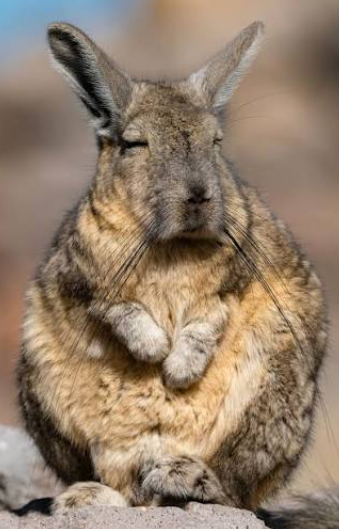

# Trabajo_Markdown_Xian_Barreiros

```markdown
# La vizcacha

## Introducción  
La vizcacha es un roedor de sudamérica, que pertenece a la familia de las chinchillas, tiene un pelaje suave y un comportamiento social.

## Tipos de vizcacha
- Vizcacha de las llanuras
- Vizcacha de montaña
- Vizcacha peruana

## Características  
- Orejas similares a las del conejo.
- Tiene un bigote largo.
- Tiene la cola enroscada.
- Mide entre 30 y 60 cm.



Wikipedia de la vizcacha [Wikipedia](https://es.wikipedia.org/wiki/Vizcacha).  

## Conclusión  
La vizcacha es un roedor sudamericano que tiene una gran capacidad de adaptación, siendo robusta como la vizcacha de las llanuras, o ágil como las vizcachas de la sierra. Ambas formas reflejan la diversidad del continente y la importancia de mantener tanto sus hábitats como sus animales.